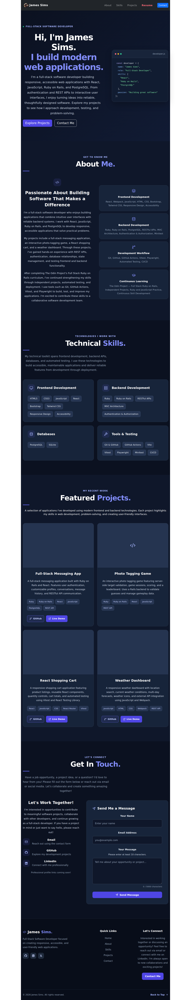
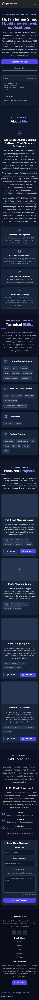

# James Sims — Developer Portfolio

[](https://jameshsims.tech/)
[](https://github.com/jameshsims91/portfolio/actions/workflows/ci.yml)

A full-stack developer portfolio showcasing my software engineering projects, technical skills, and experience building responsive, accessible web applications.

**Live Website:** https://jameshsims.tech/

## Preview

Desktop and mobile views of the live portfolio.

<!-- SCREENSHOTS_START -->

### Desktop



### Mobile



<!-- SCREENSHOTS_END -->

## Features

- Responsive, mobile-friendly interface
- Accessible navigation and interactive components
- Featured projects loaded dynamically from a Rails API
- Contact form with server-side validation and error handling
- Professional introduction, technical skills, and project highlights
- SEO metadata, Open Graph previews, and structured data
- Automated frontend testing and accessibility checks
- Production smoke testing and scheduled monitoring

## Tech Stack

### Frontend
- React
- JavaScript
- Vite
- Bootstrap
- Lucide React

### Backend
- Ruby on Rails
- PostgreSQL
- RESTful APIs

### Testing & Development
- Vitest
- React Testing Library
- Playwright
- axe-core
- Git and GitHub
- GitHub Actions

## Project Structure

```text
portfolio/
├── frontend/             # React and Vite application
├── backend/              # Ruby on Rails API
├── docs/
│   └── screenshots/      # Automated project screenshots
└── .github/
    └── workflows/        # CI and production monitoring
```

## Getting Started

### Prerequisites

- Node.js and npm
- Ruby and Bundler
- PostgreSQL

### Frontend

```bash
cd frontend
npm ci
npm run dev
```

### Backend

In another terminal:

```bash
cd backend
bundle install
bin/rails db:prepare
bin/rails server
```

Configure the application's required environment variables and database connection before starting the backend.

## Testing

Run frontend tests:

```bash
cd frontend
npm run test:run
```

Run browser tests:

```bash
npm run test:e2e
```

Run lint checks:

```bash
npm run lint
```

Build for production:

```bash
npm run build
```

Run production smoke tests:

```bash
npm run test:production
```

For backend tests:

```bash
cd backend
bin/rails test
```

## Automated Screenshots

GitHub Actions will use Playwright to capture desktop and mobile screenshots from the live portfolio.

The workflow will support manual execution and scheduled updates. Screenshots will be stored in `docs/screenshots/` and displayed in this README.

## Live Application

**Portfolio:** https://jameshsims.tech/

**API:** https://api.jameshsims.tech/

## Author

**James Sims** — Full-Stack Software Developer

- [Portfolio](https://jameshsims.tech/)
- [GitHub](https://github.com/jameshsims91)
- [LinkedIn](https://www.linkedin.com/in/james-simsiv/)
- [X](https://x.com/JamesHSimsIV)

## License

No license is currently specified for this repository.
